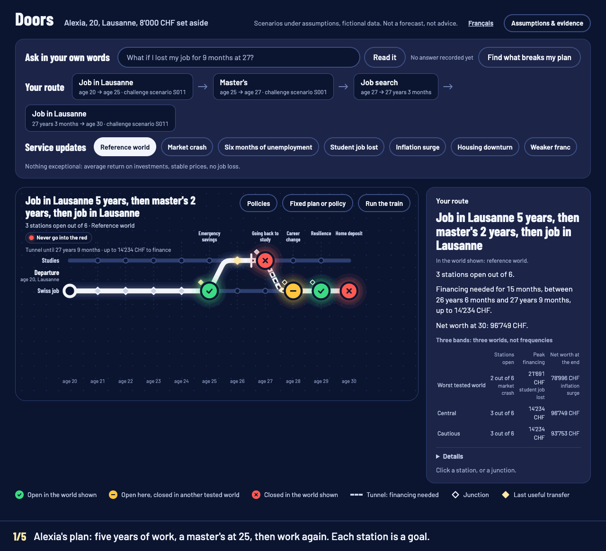

# Doors

[](https://github.com/Amine-Senhadji/DOORS/actions/workflows/tests.yml)

**Doors is a financial twin that computes policies, not plans: it does not tell Alexia what her next ten years will be, it tells her what to watch, when, and what to do if it happens.**



*Fifteen seconds of the running application: Alexia's plan, a market crash at 24, “Career change” turning red, the signpost at 26, the value table. Nothing is drawn by hand: [`scripts/demo_gif.py`](scripts/demo_gif.py) takes each picture from the application with headless Chrome.*

Built for the UBS AI Financial Twin Challenge (LauzHack 2026). Fictional data, scenarios under assumptions: not a forecast, not advice. See the [disclaimer](DISCLAIMER.md).

## The problem

Alexia is 20, lives in Lausanne and has 8'000 CHF set aside. She is the fictional persona of the challenge. She wants a master's degree, and she also wants enough set aside at 28 to change career: 39'366 CHF, a goal taken from the challenge's synthetic data.

The usual answer to “can I afford it?” is a plan and a curve: one route, one number at the end. Her plan, “work five years, a master's at 25, work again”, ends at 96'749 CHF at 30, and a number like that reads as a forecast. It holds until something happens. A market crash at 24 is enough for this plan to miss the career change by 6'268 CHF. Nobody knows whether that crash will come, and nobody can honestly say how likely it is.

The challenge asked for a twin that makes futures explorable instead of predicting one. Doors takes it literally. It does not ask “what will I have at 30?”. It asks what a goal depends on, when the last moment to change course is, and what should make her change.

## The method

The method comes from decision making under deep uncertainty, the field that plans dikes and water supplies for futures nobody can put probabilities on: Robust Decision Making and Dynamic Adaptive Policy Pathways, whose pathway maps look like metro maps. Doors draws a life the same way.

- **A map, not a curve.** A route is a line: a sequence of blocks (job in Lausanne, master's, master's while working, job in Berlin) over ten years. Every year from 21 to 29 there is a junction where Alexia can change line. Each of her six goals is a station, open or closed.
- **Named worlds, no probabilities.** A route is simulated in seven worlds: a reference world and six crises (market crash, six months of unemployment, student job lost, inflation surge, housing downturn, weaker franc). Five come from the challenge's catalogue of scenarios; the sixth, the student job lost, is ours and is labelled as such. A crisis can be moved to any age from 21 to 29, and two crises can share a world. A goal is open or closed in a world. Nothing says how likely a world is, and no result is averaged over worlds.
- **Adaptation pathways.** For each goal and each world, the engine computes the tipping point (when the route stops holding the goal), the last useful transfer (the last junction where changing line still saves it) and a signpost to watch. With a market crash at 24, the signpost of the plan reads: “If you have less than 50'100 CHF set aside (cash + investments − debts) at 26, this route no longer holds “Career change”.”
- **Policies, not plans.** A fixed plan looks at nothing. A policy is a rule with a date, a quantity and a threshold: when its date comes, it reads what Alexia has set aside, then decides. It never reads what follows. The threshold is computed, not written by hand: first the most worlds in which the goal holds, then the smallest regret in the worst world.
- **Regret is the price of not knowing.** In a world, the regret of a choice is what is missing for the goal when another option would have held it. The yardstick is a clairvoyant who knows the world in advance: a yardstick, never a course to follow.
- **The twin learns.** At a junction, Alexia can enter what she really has set aside. The engine starts again from that state and says on which side of the signpost she stands.

The six goals: never go into the red; emergency savings of 12'800 CHF at 25 and 39'366 CHF at 28 for a career change, which are Alexia's two goals in the challenge's synthetic data; and three goals of ours, stated as assumptions: two years of student life covered at 27, six months of expenses left at 29 after a 30% fall in investments, and the own funds for a 500'000 CHF home at 30.

## The value table

One table answers “what does each rule buy, and what does it cost?”. This is the one of the demo route (job in Lausanne for five years, a master's at 25, job again), for the goal the three policies aim at, “Career change”. Each cell is a full simulation of ten years, month by month.

<!-- value table: checked against the engine by tests/test_readme.py -->
| | No shock | Market crash at 24 | Six months of unemployment at 24 | Long unemployment at 24 |
|---|---|---|---|---|
| **Fixed plan**<br>The route, with nothing changed. | 3 goals of 6<br>master's finished at 27<br>regret 0 CHF | 2 goals of 6<br>master's finished at 27<br>regret 6'268 CHF | 2 goals of 6<br>master's finished at 27<br>regret 4'728 CHF | 2 goals of 6<br>master's finished at 27<br>regret 12'474 CHF |
| **Safety**<br>At 25, if you have less than 74'600 CHF set aside (cash + investments − debts): stay employed in Lausanne. | 3 goals of 6<br>master's finished at 27<br>regret 0 CHF | 5 goals of 6<br>master's not started<br>regret 0 CHF | 5 goals of 6<br>master's not started<br>regret 0 CHF | 5 goals of 6<br>master's not started<br>regret 0 CHF |
| **Balance**<br>At 26, if you have less than 50'100 CHF set aside (cash + investments − debts): stop for a job in Lausanne. | 3 goals of 6<br>master's finished at 27<br>regret 0 CHF | 4 goals of 6<br>master's stopped at 26<br>regret 0 CHF | 4 goals of 6<br>master's stopped at 26<br>regret 0 CHF | 4 goals of 6<br>master's stopped at 26<br>regret 0 CHF |
| **Ambition**<br>At 26, if you have less than 50'100 CHF set aside (cash + investments − debts): switch to the master's while working. | 3 goals of 6<br>master's finished at 27<br>regret 0 CHF | 3 goals of 6<br>master's finished at 28, while working<br>regret 2'535 CHF | 3 goals of 6<br>master's finished at 28, while working<br>regret 789 CHF | 2 goals of 6<br>master's finished at 28, while working<br>regret 8'329 CHF |
| *Clairvoyant benchmark*<br>What one would have chosen knowing the world in advance. | 3 goals of 6<br>master's finished at 27<br>stay on the plan | 4 goals of 6<br>master's stopped at 26<br>stop for a job in Lausanne | 4 goals of 6<br>master's stopped at 26<br>stop for a job in Lausanne | 4 goals of 6<br>master's stopped at 26<br>stop for a job in Lausanne |

How to read it:

- The fixed plan loses “Career change” in the three crises. Its regret is what is missing for the goal: up to 12'474 CHF.
- “Balance” starts the master's and stops it only if the savings fall short at 26. It keeps the goal in all four worlds, and with no shock it simply follows the plan.
- “Safety” decides a year earlier, before the master's starts. “Ambition” keeps the degree by finishing it while working, and misses the goal by 789 to 8'329 CHF.
- Six goals measured up to the age of 30 do not measure what a degree is worth after 30: comparing at 30 penalises the master's. The application says so on the same sheet.

A threshold fitted on four worlds proves little, so each rule is then tried on worlds it has not seen: each world left out in turn, the same crises at other ages and severities, and 200 crises drawn at random with a fixed seed. On those 200, “Balance” keeps the goal in 169, “Safety” in 163 and “Ambition” in 112, where the clairvoyant keeps it in all 200. A rule with one threshold is not optimal, and Doors shows by how much.

## Two crises in a row: −64'427.29 CHF, against −30'113.53 for their sum

A world can hold two crises, and the engine simulates that world: it does not add two results. On ten years of work in Lausanne, counted as net worth at 30 against the same route with no crisis:

| World | Net worth at 30 | Goals lost |
|---|---|---|
| Long unemployment at 23 | −15'001.97 CHF | 1: Home deposit |
| Long unemployment at 24 | −15'111.56 CHF | 1: Home deposit |
| The sum of the two | −30'113.53 CHF | |
| **Both in the same world** | **−64'427.29 CHF** | **4: Never go into the red, Emergency savings, Going back to study, Home deposit** |

The reason is written in the ledger. For eleven months of the second year, a line says so: “No unemployment benefit: 11 months contributed out of 24, 12 are required”, then 10, then 9, down to 1. After a first year without a job, Alexia has not contributed long enough to be covered again.

It also goes the other way. A long unemployment at 24 followed by a market crash at 25 costs 24'768.05 CHF, which is 2'500.23 CHF less than the sum of the two taken alone: after a year without a job she has fewer investments left to lose.

## How it is verified

- **To the cent against the reference model.** The challenge's starter kit is a cash-only engine. With everything it does not have switched off through the assumptions (social contributions, tax, 2nd pillar, investments, interest), Doors gives the same 120 monthly balances, to the cent, on its three scenarios. No file of the engine is changed for this: see [`tests/test_vs_starter_kit.py`](tests/test_vs_starter_kit.py). The application runs the same comparison live, in its “Assumptions & evidence” drawer.
- **473 tests**, run by `unittest` and by `pytest`, in about seven minutes. They include the pages themselves, read in headless Chrome in English and in French, and this README: every figure on this page is checked against the engine by [`tests/test_readme.py`](tests/test_readme.py).
- **Continuous integration.** Every push to `main` and every pull request runs both suites on GitHub Actions ([`.github/workflows/tests.yml`](.github/workflows/tests.yml)): `unittest` and `pytest`, side by side, with the Google Chrome of the runner. Where there is no Chrome, the tests that read the page in a browser are skipped and the rest runs. No secret is needed: no test calls a model.
- **Every franc is accounted for.** Each month has a ledger, and its accounting identities are checked in the tests and live in the drawer, on the route on screen with the assumptions on screen.
- **The engine is deterministic.** A simulation draws nothing at random: same assumptions, same result, to the cent. The 200 crises that try the policies are drawn with a fixed seed.
- **The challenge's catalogue of 120 scenarios**: 98 run (56 modelled, 42 approximated, with the approximation written down) and 22 are not covered, each with the operation that is missing. See [`reports/coverage.md`](reports/coverage.md), in French.
- **The tests were tested** for the AI layer: its code was weakened in one place at a time, and a test had to notice each time.

## The AI layer, as it stands

One rule: **the model never computes a figure. The engine decides.**

- **“Find what breaks my plan”.** A model proposes worlds to test, one crisis or two, through a single tool. Code holds the budget: 5 calls of 8 worlds, so 40 worlds out of 49'140. The engine simulates each one, ranks them, and checks the search itself by simulating the 315 single crises on its own. The model then writes one or two sentences per world, and a checker made of plain code refuses any text holding a figure the engine did not give for that world. After three refusals, the screen shows the engine's figures alone and says the explanation was rejected.
- **“Ask in your own words”.** One sentence (“What if I lost my job for 9 months at 27?”) is read into the settings Doors already has: a route, one crisis or two, assumptions, savings. They are shown, and can be changed or unticked, before anything is computed. What Doors cannot set is said, not approximated.
- **Two modes.** Live, the server calls Claude Sonnet 5.5 through the Anthropic API: it takes both `DOORS_AI=live` and a key, so a key alone never makes the page spend. Otherwise it plays recorded answers again, and checks them again on the engine of today.

Where it stands, plainly: the AI layer is **written and tested, and has not yet been evaluated with a real model**. No test calls the API: they run on scripted stand-ins. No answer is recorded yet, so the page says “No answer recorded yet” and shows what the engine finds on its own.

What already exists is the true answer and the yardstick. For three routes, the engine scanned every world of the space offline, 49'140 per route, and a random search with the agent's budget was repeated 1'000 times:

<!-- benchmark table: checked against benchmarks/truth.json and benchmarks/random.json by tests/test_readme.py -->
| Route | With no crisis | The hardest worlds, by the full scan | Random search, 40 worlds | The agent, 40 worlds |
|---|---|---|---|---|
| Demo route | 3 goals of 6 | 3 goals lost, in 47 worlds of 49'140 | finds one in 51 draws of 1'000 (3.76% of all possible draws) | not measured yet |
| Ten years of work in Lausanne | 6 goals of 6 | 5 goals lost, in 21 worlds of 49'140 | finds one in 15 draws of 1'000 (1.70% of all possible draws) | not measured yet |
| Ten years in Berlin | 5 goals of 6 | 4 goals lost, in 53 worlds of 49'140 | finds one in 56 draws of 1'000 (4.23% of all possible draws) | not measured yet |

The last column is empty on purpose. The runs with the real model, ten per route, will be reported here whatever they say, with the number of rewrites the checker had to ask for.

One limit to keep in mind: the checker verifies that every figure of a text comes from the engine and from the right world. It does not verify the reasoning of the words around the figures.

## Install and run

Python 3.12 is the version the tests run on. From the root of the repository:

```bash
python3.12 -m venv .venv
.venv/bin/pip install -r requirements.txt
.venv/bin/python -m api                           # then open http://127.0.0.1:8000/
.venv/bin/python -m unittest discover -s tests    # the 473 tests; .venv/bin/python -m pytest runs the same set
```

- The interface is in English; add `?lang=fr` to the address for French. The figures are the same.
- Nothing is loaded from the internet: the fonts are in the repository, and the AI layer starts in recorded mode.
- The tests of the pages need Google Chrome; `CHROME_BIN` names it when it is not in one of the usual places. Without it they are skipped, each with its reason, and the rest runs: [`tests/test_browser.py`](tests/test_browser.py) hides the browser for real and checks that.
- Addresses worth trying: `/?monde=krach@24` (the market crash at 24), `/?politiques=1` (the value table), `/?regle=1` (a widespread rule put to the test), `/?stress=1` and `/?ask=…` (the two sheets of the AI layer).
- Live mode: `DOORS_AI=live ANTHROPIC_API_KEY=… .venv/bin/python -m api`. Before spending anything, `.venv/bin/python scripts/record_ai.py record --dry-run` shows what would be sent and what it would cost.

## Deploy a demo on Render

The repository is ready for a free online demo. Nothing is deployed from it: the deploy is done in Render, by whoever owns the account.

- [`Dockerfile`](Dockerfile): Python 3.12.15 on a slim Debian 13 image, the dependencies of `requirements.txt`, and the server run by a user with no rights over the files. It listens on `0.0.0.0` and on the port in `$PORT`.
- [`render.yaml`](render.yaml): a [Blueprint](https://render.com/docs/blueprint-spec) with one web service, on the free plan, built from that Dockerfile.
- **No key and no secret.** The service starts in recorded mode (`DOORS_AI=recorded`): no request leaves it, and the AI sheets show the recorded answers, or say that there is none and show what the engine finds on its own. Nothing has to be configured in Render, and a key that was added to the environment would not change this.

To deploy it:

1. Push the repository to GitHub.
2. In the Render dashboard, choose **New → Blueprint** and pick the repository. Render reads `render.yaml` and proposes one service, `doors`.
3. Apply it. The first build takes a few minutes. Then the page is at the address that Render gives to the service.

Later deploys follow the branch, but only once its checks pass (`autoDeployTrigger: checksPass`): the tests of the [workflow](.github/workflows/tests.yml) have to be green.

**The free plan puts the service to sleep.** [Render spins a free web service down](https://render.com/docs/free) after 15 minutes without a request, and spins it up again at the next one. That takes about a minute, during which the browser shows a loading page: the first load of the demo is slow, and the next ones are not. The free plan gives the service [512 MB of memory and a tenth of a CPU](https://render.com/docs/compute-plans); the server holds less than 200 MB once every route of the page has been asked, and a test checks it.

To try the container on your machine first, if you have Docker:

```bash
docker build -t doors .
docker run --rm -p 8000:8000 doors              # then open http://127.0.0.1:8000/
```

Render sets the port itself, in `PORT`; `-e PORT=10000 -p 10000:10000` does the same here. [`tests/test_container.py`](tests/test_container.py) starts the server with the command of the Dockerfile, in the build context that `.dockerignore` leaves, and asks it for every route of the page. With `DOORS_TEST_DOCKER=1` it also builds the image.

## Architecture

```text
┌──────────────────────────────────────────────────────────────────────────────┐
│ web/      the map and its sheets; no figure is computed in the browser       │
└──────────────────────────────────────┬───────────────────────────────────────┘
                                       │ JSON
┌──────────────────────────────────────▼───────────────────────────────────────┐
│ api/      FastAPI: the routes, and the page itself                           │
└──────────────┬───────────────────────────────────────────────┬───────────────┘
               │                                               │
┌──────────────▼───────────────────┐      ┌────────────────────▼───────────────┐
│ engine/                          │      │ ai/                                │
│ deterministic, standard library  │◄─────┤ the model proposes and writes;     │
│ only: every figure comes from it │      │ the engine simulates and ranks,    │
└──────────────┬───────────────────┘      │ code checks every figure           │
               │                          └────────────────────┬───────────────┘
┌──────────────▲───────────────────┐      ┌────────────────────▼───────────────┐
│ Data/, starter-kit/              │      │ a model, live (Anthropic API),     │
│ the challenge's files, unchanged │      │ or its recorded answers            │
└──────────────────────────────────┘      └────────────────────────────────────┘
```

The engine never calls a model, and the AI layer never computes a figure. The challenge's files are read and quoted, never written.

| Folder | What it holds |
|---|---|
| [`engine/`](engine/) | The financial model: one month after another, a ledger for each month, simplified Swiss rules. `transition.py` is the monthly step, `worlds.py` the named crises, `tree.py` the junctions and the signposts, `policy.py` the rules and the value table, `assumptions.py` every assumption with its nature and its source. |
| [`api/`](api/) | The routes: `/path`, `/node`, `/pathways`, `/policies`, `/worlds`, `/ai/stress`, `/ai/ask` and the others. |
| [`web/`](web/) | The interface. Every text is in `texts.en.js` and `texts.fr.js`; every figure comes through `api.js`. |
| [`ai/`](ai/) | The checker, the two functions, the live and recorded modes, the benchmark. |
| [`tests/`](tests/) | The tests. `test_vs_starter_kit.py` is the equality with the reference model, `test_ai_screen.py` the AI layer read in Chrome. |
| [`benchmarks/`](benchmarks/), [`scripts/`](scripts/) | The full scan and the random baseline, and the commands that make them, record answers and run the agent. |
| [`Dockerfile`](Dockerfile), [`render.yaml`](render.yaml) | The container of the online demo, and its Render Blueprint. |
| [`Data/`](Data/), [`starter-kit/`](starter-kit/) | The challenge's files, unchanged. |

## Limits

The whole list is in [docs/LIMITS.md](docs/LIMITS.md) ([en français](docs/limits.fr.md)), and the application shows it as it is in its drawer. The ones that matter most:

- **Simplified Swiss rules.** The income tax scale is illustrative, and several figures (AVS, unemployment insurance, 2nd pillar, health insurance) are marked “to be verified” and are not verified.
- **Named worlds only.** No Monte Carlo, no crisis calibrated on real data, and nothing about how often a world comes.
- **The goals stop at 30.** What a degree is worth later is not measured, which penalises the master's.
- **Simple policies.** One threshold, on one quantity, at one date, calibrated on four worlds for one goal.
- **The AI layer is not yet evaluated with a real model**, its search tests 40 worlds out of 49'140, and its checker checks figures, not reasoning.
- **Fictional data.** The synthetic profiles do not represent the Swiss population.
- **Part of the code is still commented in French**: the engine and the older tests. The interface, the AI layer and the documents are in English.

## Credits

- **The challenge, its synthetic data and its starter kit**: [Stefania Stan](https://www.linkedin.com/in/stefania-s/), challenge author and information owner. The files in `Data/` and `starter-kit/` are included unchanged, with her permission, and are not covered by this project's licence.
- **Authors**: Amine Senhadji (interface, decision policies, AI layer and portfolio). The engine was co-written with a teammate during the hackathon; his name will be added with his agreement. See [NOTICE](NOTICE).
- **The method** borrows from Robust Decision Making (Lempert, Popper and Bankes, 2003) and Dynamic Adaptive Policy Pathways (Haasnoot, Kwakkel, Walker and ter Maat, 2013).
- **Fonts**: Barlow and Barlow Condensed, under the SIL Open Font License 1.1.
- **Claude Code.** This project was built with Claude Code, Anthropic's coding agent. The method, the rules of the project and every decision are the author's, and each step was reviewed before the next one started; the agent wrote a large part of the code, of the tests and of this page under that direction. The commits it co-wrote say so.
- **Licence**: MIT for the project's own code, see [LICENSE](LICENSE). The notes that go with it are in [NOTICE](NOTICE).
